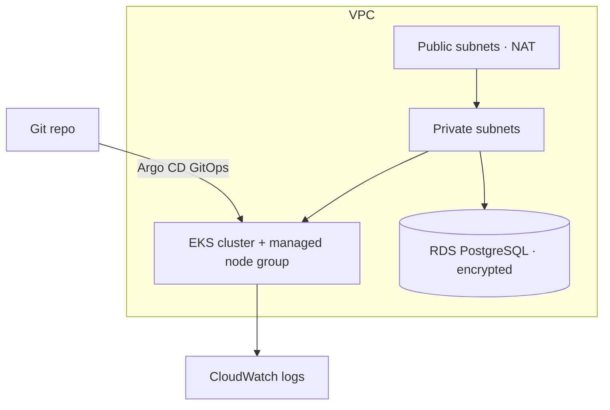

# aws-eks-platform — AWS infrastructure as code + GitOps

> Reusable **Terraform** modules that provision an **AWS EKS** platform — VPC,
> EKS cluster + managed nodes, encrypted **RDS PostgreSQL**, and **CloudWatch**
> logging — plus **Argo CD** app-of-apps manifests for GitOps delivery and
> GitHub Actions for validation and credential-gated apply.


> ℹ️ An **original reference implementation**. No proprietary code or data.

---

## What it provisions



Four hand-written, reusable modules:

| Module | Builds |
| --- | --- |
| [`network`](terraform/modules/network) | VPC, public/private subnets across AZs, IGW, NAT gateways, route tables (with EKS subnet tags) |
| [`eks`](terraform/modules/eks) | EKS cluster + managed node group, with least-privilege IAM roles and control-plane logging |
| [`rds`](terraform/modules/rds) | Encrypted PostgreSQL in private subnets, locked to the VPC by security group |
| [`observability`](terraform/modules/observability) | CloudWatch log group for the cluster |

GitOps: [`argocd/app-of-apps.yaml`](argocd/app-of-apps.yaml) manages child
Applications (e.g. [`argocd/apps/api.yaml`](argocd/apps/api.yaml)), which sync the
Kubernetes manifests under [`k8s/`](k8s) — so deploying is a Git commit.

---

## Use it

```bash
cd terraform
terraform init
terraform fmt -recursive -check
terraform validate
terraform plan -var="db_password=$(openssl rand -base64 24)"
# terraform apply   # needs AWS credentials
```

CI runs `fmt -check`, `init -backend=false`, and `validate` on every push
([.github/workflows/terraform.yml](.github/workflows/terraform.yml)); a manual,
credential-gated workflow runs `apply`
([.github/workflows/deploy.yml](.github/workflows/deploy.yml)).

---

## Design decisions

- **Own modules, not registry modules** — the VPC/EKS/RDS wiring is explicit and
  reviewable, demonstrating the IaC rather than hiding it behind a black box.
- **Private-subnet workloads, public-subnet NAT** — nodes and the database have
  no public ingress; egress goes through NAT.
- **Least-privilege IAM** — separate cluster and node roles with only the AWS
  managed policies each needs.
- **GitOps over kubectl** — Argo CD reconciles the cluster to Git, so changes are
  reviewed, versioned, and auto-healed.

---

*An original reference implementation. No proprietary code or data is included.*
